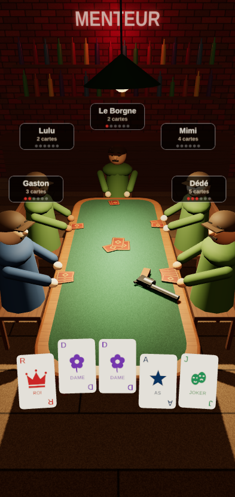
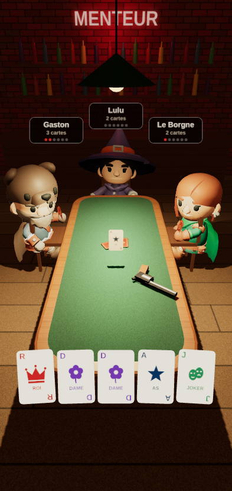
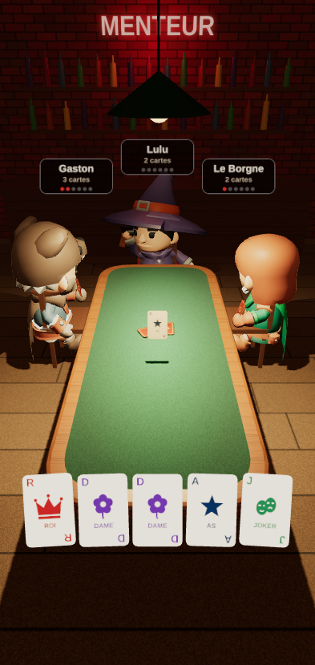
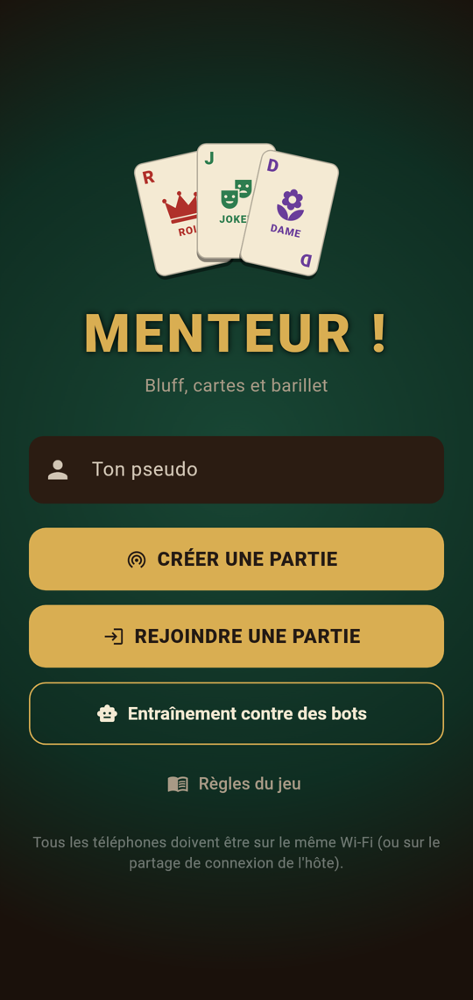
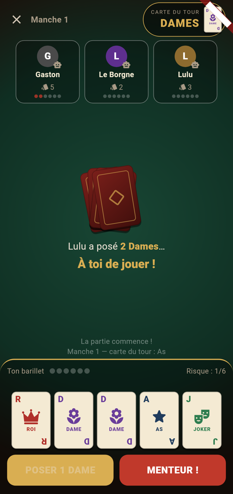
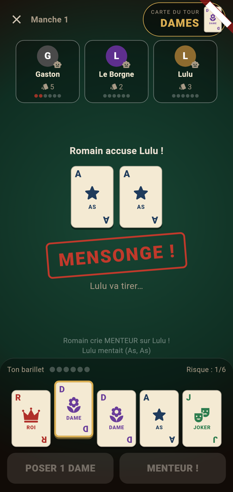
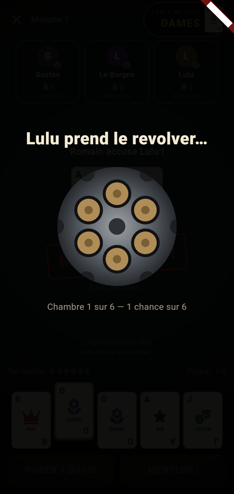
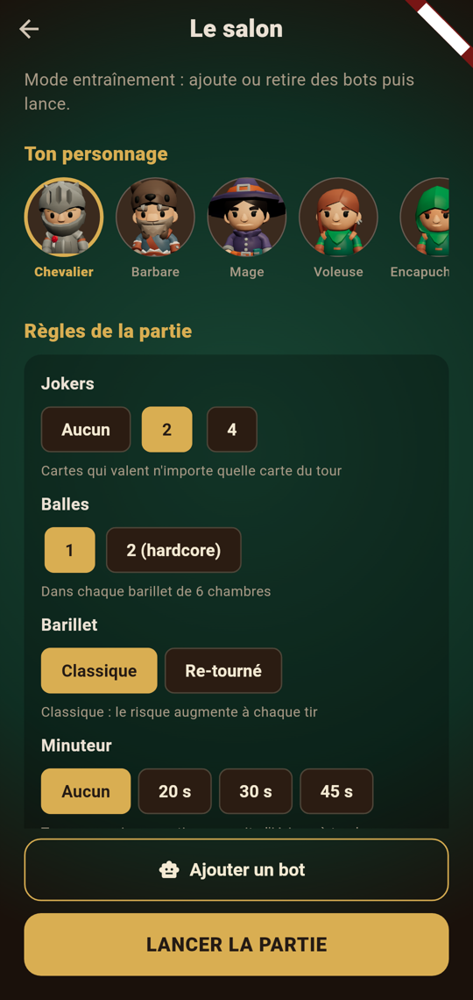

# Menteur !

Jeu de cartes de bluff avec roulette russe en **3D**, pour jouer entre amis **en réseau local**
(même Wi-Fi ou partage de connexion), sur Android. Sans serveur, sans compte, sans Internet.

<p>
  
  
  
</p>

Une table 2D reste disponible (interrupteur « Table en 3D » sur l'accueil) pour les téléphones
peu puissants, et s'active automatiquement si la 3D ne peut pas démarrer.

<p>
  
  
  
  
</p>

## Règles

- Paquet : 6 Rois, 6 Dames, 6 As, 2 Jokers (agrandi automatiquement à 5–6 joueurs).
- Chaque manche : 5 cartes par joueur et une **carte du tour** tirée au hasard (Roi, Dame ou As).
- À ton tour, tu poses 1 à 3 cartes face cachée en prétendant que ce sont des cartes du tour.
  Les Jokers comptent comme n'importe quelle carte. Tu peux mentir.
- Le joueur suivant peut jouer à son tour ou crier **MENTEUR !** : les cartes sont révélées,
  et le menteur (ou l'accusateur, s'il avait tort) appuie sur la détente.
- Chaque joueur a son revolver : 6 chambres, 1 balle placée au hasard. Le risque monte à chaque tir.
- Un joueur sans carte est sauté ; le dernier à avoir des cartes doit accuser.
- Dernier survivant = vainqueur.

## Salon : personnage et règles



Chacun choisit son personnage parmi les 5 aventuriers. L'hôte règle la partie :

- **Jokers** : 0, 2 (par défaut) ou 4 ;
- **Balles** : 1 ou 2 par barillet (mode hardcore) ;
- **Barillet** : classique (le risque monte à chaque tir) ou re-tourné avant chaque tir (risque
  constant) ;
- **Minuteur** : aucun, 20, 30 ou 45 s. Passé le délai, l'IA joue (ou tire) à la place du joueur,
  avec un compte à rebours et des vibrations sur les dernières secondes.

## Sons

Cartes distribuées et posées, coup sur la table quand on accuse, buzzer ou carillon à la
révélation, barillet qui tourne, clic ou coup de feu, musique de victoire ou de défaite, et une
ambiance de bar en fond. Tous les sons sont **synthétisés** par `tool/make_sounds.py` (pas
d'enregistrement tiers). Bouton pour couper le son en haut de la table.

<br clear="right">

## Jouer en classe

1. Un joueur appuie sur **Créer une partie** : l'écran du salon affiche son adresse IP.
2. Les autres appuient sur **Rejoindre** : la partie apparaît automatiquement
   (sinon, ils tapent l'adresse IP).
3. L'hôte peut compléter la table avec des bots (2 à 6 joueurs), puis lance la partie.

Si le Wi-Fi de l'école isole les appareils (fréquent), l'hôte active le **partage de connexion**
et les autres s'y connectent : le jeu ne consomme pas de données mobiles, tout passe en local.

Un joueur qui perd la connexion est remplacé par un bot et reprend sa place s'il revient.

## Récupérer l'APK

Chaque push déclenche la CI GitHub Actions (`.github/workflows/build-apk.yml`) :
analyse, tests, puis compilation de l'APK.

- **APK d'un commit** : onglet *Actions* → dernier run → artefact `menteur-apk`.
- **Version à partager** : pousser un tag, la CI crée une *Release* avec l'APK téléchargeable
  sans compte GitHub :
  ```bash
  git tag v1.0.0 && git push origin v1.0.0
  ```

Sur le téléphone, il faut autoriser l'installation d'applications de sources inconnues.
Tous les APK sont signés avec la même clé (`android/app/menteur-shared.keystore`, volontairement
commitée), donc une nouvelle version s'installe par-dessus l'ancienne. Pour une publication sur
le Play Store, il faudrait une clé privée.

## Développement

Prérequis : Flutter 3.50 (stable), JDK 21, Node 22 pour la scène 3D, le SDK Android pour compiler l'APK en local.

```bash
flutter pub get
flutter test                 # règles, 2000 parties de bots, partie réseau complète
flutter run                  # sur un téléphone branché en USB
flutter build apk --release  # APK dans build/app/outputs/flutter-apk/
```

La scène 3D vit dans `web3d/` (three.js, tout est généré en code : aucun modèle ni image à
télécharger). Après une modification :

```bash
cd web3d && npm install && npm run build   # régénère assets/table3d.html (commité)
```

On peut l'ouvrir directement dans un navigateur et la piloter depuis la console avec
`table3d.update({...})` (format : `GameEngine.viewFor` dans `lib/game/engine.dart`).

Pour tester le multijoueur sur un seul PC : lancer deux émulateurs, ou un émulateur et un téléphone,
puis rejoindre par IP.

### Architecture

```
lib/
  game/      Moteur pur Dart, sans Flutter ni réseau : testable
    cards.dart     cartes, composition du paquet
    engine.dart    machine à états (salon → jeu → révélation → roulette → fin)
    view.dart      vue d'un joueur (mains adverses et balles masquées)
    bot.dart       IA, qui ne voit que ce qu'un humain verrait
  net/       Réseau local
    protocol.dart  messages JSON, adresses locales
    discovery.dart annonce UDP broadcast (port 4041) + écoute
    platform.dart  verrou multicast Android (MainActivity.kt)
  session/   Ce que l'UI consomme
    host_session.dart   moteur + bots + serveur WebSocket (port 4040)
    client_session.dart client WebSocket avec reconnexion automatique
  ui/        Écrans Flutter (accueil, rejoindre, salon, table, roulette, fin)
    table3d/       WebView qui affiche la scène 3D + interface par-dessus
web3d/       Scène 3D three.js (salle, table, personnages, cartes, revolver)
  src/characters.js personnages KayKit animés (gestes, IK du bras)
  models/          personnages et animations compressés (CC0)
  src/main.js      synchronisation avec l'état, animations, taps sur les cartes
  src/models.js    modèles low-poly construits en code
  src/textures.js  textures dessinées sur canvas
assets/table3d.html  scène compilée en un seul fichier (hors ligne)
```

La scène 3D n'est qu'un **affichage** : Flutter lui envoie l'état de la partie
(`table3d.update(état)`) et elle renvoie les cartes touchées (`{t:'tap', id}`). Les règles et le
réseau restent côté Dart, donc testés indépendamment du rendu.

L'**hôte fait autorité** : lui seul fait tourner le moteur et envoie à chaque joueur sa propre vue.
Les clients ne reçoivent jamais les cartes des autres ni la position des balles, donc on ne peut pas
tricher en inspectant le trafic.

## Personnages et animations

Les adversaires sont les personnages du pack **KayKit Adventurers** (chevalier, barbare, mage,
voleuse, voleuse encapuchonnée) par [Kay Lousberg](https://www.kaylousberg.com), sous licence
**CC0** (domaine public, voir `web3d/models/LICENSE-KayKit.txt`). Chaque joueur garde la même
apparence sur tous les téléphones.

Animations utilisées (squelette commun, 13 clips sur les 76 du pack) :

| Moment du jeu | Animation |
| --- | --- |
| Attente | assis (`Sit_Chair_Idle`), cartes en éventail dans la main gauche, petits gestes, tête tournée vers le joueur actif |
| Poser des cartes | lancer (`Throw`), les cartes partent de sa main vers le tas |
| Crier « Menteur ! » | l'accusateur frappe (`Punch_A`), l'accusé se protège (`Block`) |
| Révélation | le menteur démasqué encaisse (`Hit_B`), l'innocent se réjouit (`Cheer`) |
| Roulette | le bras porte le revolver à la tempe (cinématique inverse), puis soulagement (`Cheer`) ou effondrement sur la table |
| Coup de feu | les autres sursautent (`Hit_A` / `Hit_B`) |
| Victoire | célébration en boucle |

Le bas du corps reste assis pendant que le haut du corps joue les gestes : les clips sont
coupés en deux (`web3d/src/characters.js`). Pour régénérer les modèles depuis le pack officiel :

```bash
cd web3d && node tools/prepare-models.mjs   # retire armes et clips inutiles, compresse (meshopt)
cd web3d && node tools/render-portraits.mjs # avatars du salon (assets/portraits/, via Playwright)
python3 tool/make_sounds.py                 # régénère assets/sounds/
```

## Pistes pour la suite

- Sons (déclic, coup de feu, ambiance de bar), via le paquet `audioplayers`
- Expressions faciales des personnages
- Minuteur de tour configurable (un bot joue si un joueur est absent)
- Variantes : nombre de jokers, re-rotation du barillet à chaque manche, mode « dés »
- Chat rapide / émotes pendant la partie
- Statistiques locales (victoires, bluffs réussis)
- Version iOS (le code est compatible, il faut un Mac pour compiler)
